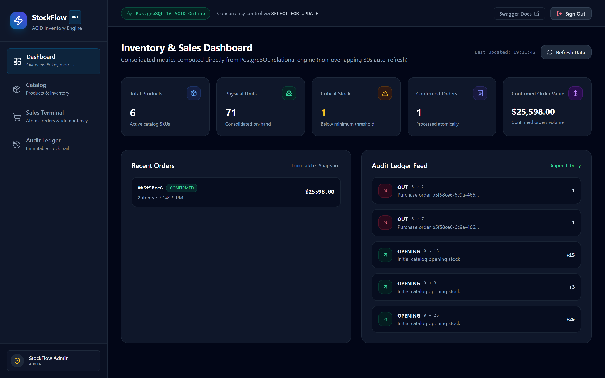
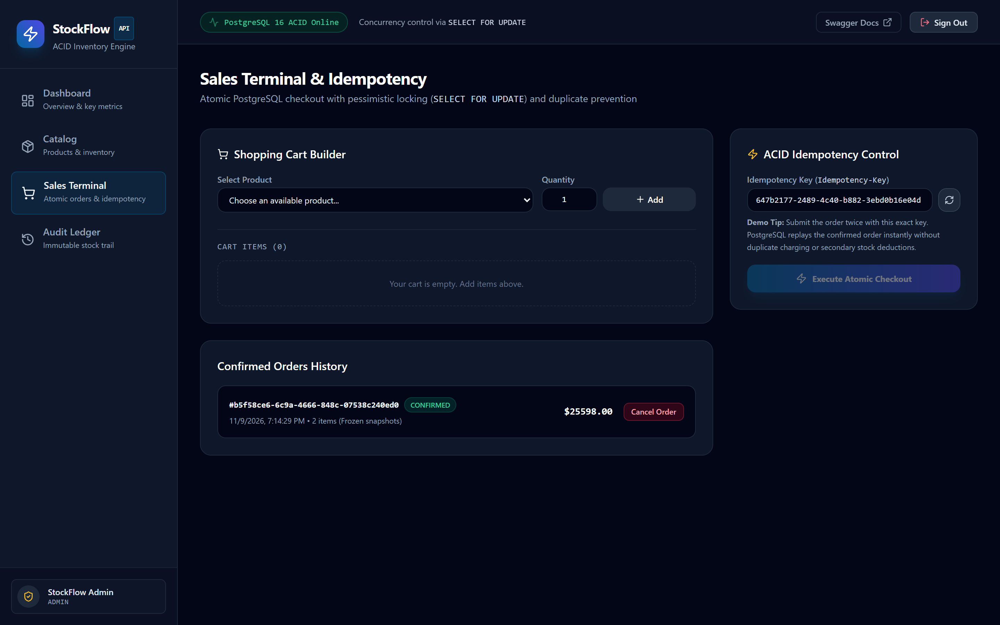
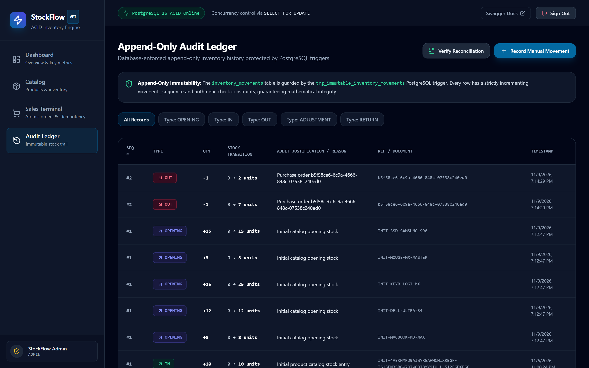
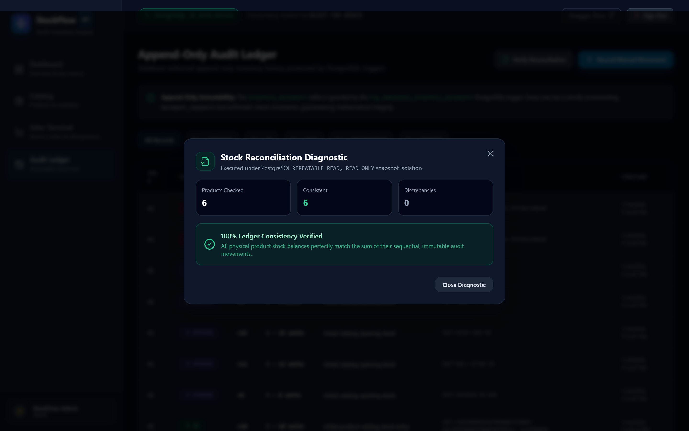
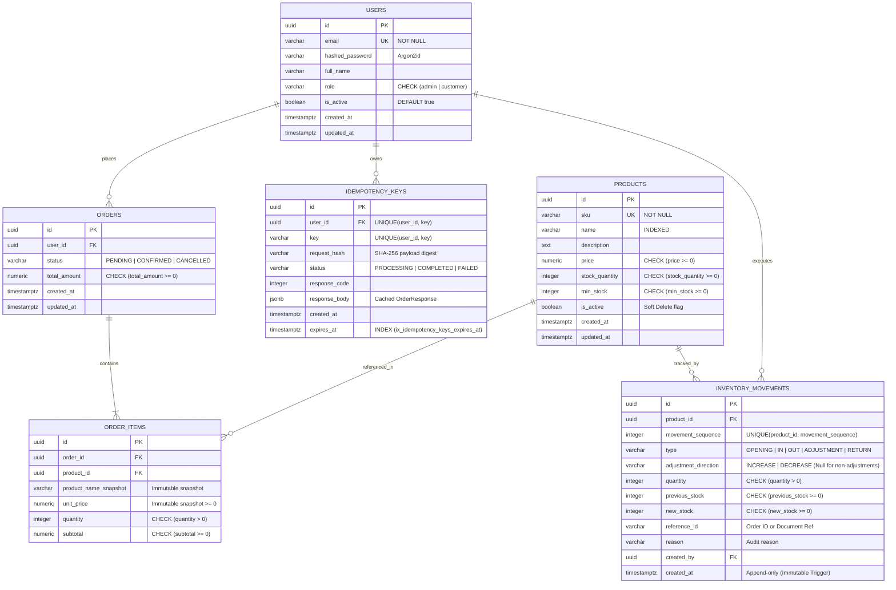
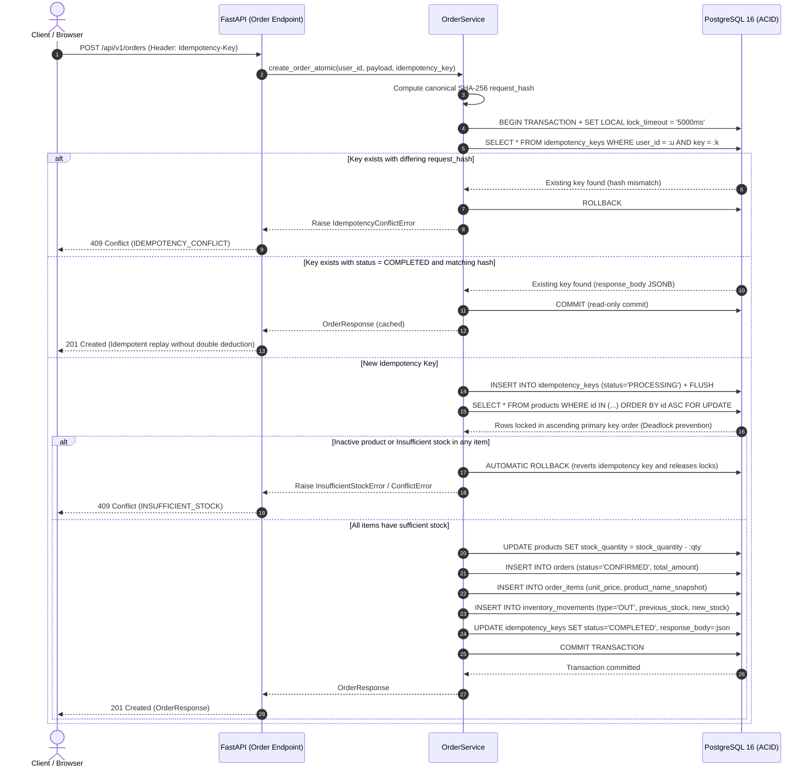

# StockFlow API — High-Integrity Inventory & Order Engine

[](https://github.com/ledrodh/stockflow-api/actions/workflows/main.yml)
[-06b6d4?style=flat&logo=github)](https://ledrodh.github.io/stockflow-api/)
[-brightgreen?style=flat&logo=pytest)](https://github.com/ledrodh/stockflow-api/actions)
[](https://github.com/ledrodh/stockflow-api/actions)
[](https://github.com/ledrodh/stockflow-api/actions)
[](https://github.com/ledrodh/stockflow-api/actions)
[](https://github.com/ledrodh/stockflow-api/actions)
[](https://python.org)
[](https://fastapi.tiangolo.com)
[](https://postgresql.org)

**StockFlow API** is an enterprise-grade transactional inventory management engine built with database-enforced integrity, atomic order processing, pessimistic concurrency control (`SELECT ... FOR UPDATE`), database-backed persistent idempotency, and an Append-Only Immutable Inventory Ledger. Moving beyond simple CRUD patterns, StockFlow implements ACID atomic transactions, pessimistic locking with lock-inversion deadlock prevention, and multi-layered audit trails.

---

## 🌐 Live Interactive Demo

A fully interactive, client-isolated demonstration is hosted and ready for instant evaluation without cloning or local setup:

👉 **[Launch StockFlow Live Web Dashboard](https://ledrodh.github.io/stockflow-api/)**

### Demo Login Shortcuts:
| Role | Email | Password | Permissions |
| :--- | :--- | :--- | :--- |
| **Administrator** | `admin@stockflow.io` | `AdminPassword123!` | Full Dashboard KPIs, Catalog CRUD, Manual Stock Ledger Entries, 3-Tier Snapshot Reconciliation |
| **Customer** | `customer@stockflow.io` | `CustomerSecret#2026` | Catalog browsing, Shopping Cart, Atomic Checkout, Idempotency Replays, Order Cancellation |

> **Note for Reviewers:** In the live web environment, the frontend features an in-browser transactional engine that simulates ACID checks, stock exhaustion, idempotent retries, and ledger reconciliation in an isolated sandbox.

---

## 📸 Interface & Dashboard Walkthrough

### 1. Executive Dashboard (Live Relational KPIs & Alerts)
Real-time consolidated KPIs (Active SKUs, Physical Stock on Hand, Critical Low-Stock Alerts, Confirmed Orders, and Total Revenue) computed directly with non-overlapping 30s auto-refresh intervals.



---

### 2. Sales Terminal & Cryptographic Idempotency Testing
Interactive cart builder with custom `Idempotency-Key` headers, atomic checkout under row-level locks, instant cancellation with automatic inventory restock, and visual validation of duplicate prevention.



---

### 3. Append-Only Audit Ledger & Snapshot Reconciliation
Immutable history of stock transactions (`OPENING`, `OUT`, `IN`, `ADJUSTMENT`, `RETURN`) guarded by PostgreSQL triggers and strictly sequential `movement_sequence`. The 3-tier diagnostic report confirms sequence continuity, chain integrity, and arithmetic balance.





---

## 🎯 Engineering Highlights

1. **Database-Level Concurrency Control (`SELECT ... FOR UPDATE`):**
   - High-contention purchase requests competing for the remaining units of a product are serialized at the PostgreSQL row level.
   - Products within multi-item orders are sorted deterministically by primary key (`ORDER BY products.id ASC`) prior to lock acquisition, eliminating circular deadlocks caused by concurrent carts acquiring locks in conflicting orders.
2. **Transactional PostgreSQL Idempotency (`UNIQUE(user_id, key)`):**
   - The `Idempotency-Key` is persisted and validated within the **exact same ACID transaction** that deducts stock and creates orders, avoiding the *Dual-Write Problem* common to Redis-only architectures.
   - Deterministic `SHA-256` payload hashing: repeating the same key returns the existing order (`201 Created`) without secondary debits; altering the payload while reusing the key triggers an immediate `409 Conflict` (`IDEMPOTENCY_CONFLICT`).
3. **Immutable Inventory Ledger (`InventoryMovement`):**
   - Every stock alteration appends an immutable entry capturing `previous_stock`, `new_stock`, `type` (`IN`, `OUT`, `RETURN`, `ADJUSTMENT`), `reference_id`, and `reason`.
   - Hardened across two layers: SQLAlchemy ORM event listeners and a **native PostgreSQL trigger** (`trg_immutable_inventory_movements`) blocking raw `UPDATE` and `DELETE` queries.
4. **Historical Snapshots & Soft Deletion:**
   - `OrderItem` preserves frozen `unit_price` and `product_name_snapshot` values at the time of purchase.
   - Products are never physically deleted (`is_active = False`), safeguarding relational foreign key integrity across historical transactions.
5. **Modern Security & Role-Based Access Control (RBAC):**
   - Password hashing with **Argon2id** via `pwdlib[argon2]`.
   - Short-lived signed JWT access tokens with strict role separation (`admin` vs `customer`) and forbidden privilege escalation (`extra="forbid"` on public schemas).

---

## 📐 Architecture & Diagrams

### 1. Entity-Relationship Diagram (ERD)



---

### 2. Sequence Diagram: Atomic Purchase Transaction



### 3. Order Cancellation and Inventory Restock Engine

```mermaid
sequenceDiagram
    autonumber
    actor Client as Customer / Admin
    participant API as FastAPI (/orders/{id}/cancel)
    participant Svc as OrderService
    participant DB as PostgreSQL 16 (ACID)

    Client->>API: POST /api/v1/orders/{order_id}/cancel
    API->>Svc: cancel_order_atomic(order_id, user_id, is_admin)

    Svc->>DB: BEGIN TRANSACTION + SET LOCAL lock_timeout = '5000ms'
    Svc->>DB: SELECT * FROM orders WHERE id = :order_id FOR UPDATE

    alt Order not found or permission denied
        Svc->>DB: ROLLBACK
        Svc-->>API: Raise NotFoundError / PermissionDeniedError
        API-->>Client: 404 Not Found / 403 Forbidden
    else Order is already CANCELLED
        Svc->>DB: COMMIT (read-only commit)
        Svc-->>API: OrderResponse (idempotent replay)
        API-->>Client: 200 OK (replays current state without double-restocking)
    else Order status != CONFIRMED
        Svc->>DB: ROLLBACK
        Svc-->>API: Raise ConflictError
        API-->>Client: 409 Conflict (invalid transition)
    else Order is CONFIRMED
        Svc->>DB: SELECT * FROM products WHERE id IN (...) ORDER BY id ASC FOR UPDATE
        DB-->>Svc: Product rows locked deterministically
        Svc->>DB: UPDATE products SET stock_quantity = stock_quantity + :qty (Restock items)
        Svc->>DB: INSERT INTO inventory_movements (type='RETURN', previous_stock, new_stock)
        Svc->>DB: UPDATE orders SET status = 'CANCELLED'
        Svc->>DB: COMMIT TRANSACTION
        DB-->>Svc: Transaction committed
        Svc-->>API: OrderResponse (status=CANCELLED)
        API-->>Client: 200 OK (OrderResponse)
    end
```



---

## 📚 Architecture Decision Records (ADRs)

Core architectural choices are documented in [`docs/adr`](docs/adr):

- [**ADR-001: PostgreSQL as Single Source of Truth for Transactional Idempotency**](docs/adr/ADR-001-postgresql-idempotency.md)
- [**ADR-002: Pessimistic Concurrency Control with `SELECT FOR UPDATE` and Deterministic Ordering**](docs/adr/ADR-002-select-for-update-concurrency.md)
- [**ADR-003: Append-Only Immutable Inventory Ledger (`InventoryMovement`) and Historical Snapshots**](docs/adr/ADR-003-immutable-inventory-movements.md)

---

## 🖥️ StockFlow Dashboard (Web Admin Interface)

StockFlow includes a responsive **Single Page Application (SPA)** in [`frontend/`](frontend) built with **React, TypeScript, Vite, and Tailwind CSS**:

- **Real-Time KPIs:** Live overview metrics (Active SKUs, Physical Stock Units, Low Stock Alert below configurable `min_stock`, Confirmed Orders, and Total Revenue).
- **Product Catalog Management:** Dynamic search by name or SKU, server pagination, and soft deletion.
- **Sales Terminal & Idempotency Testing:** Multi-item cart builder with customizable `Idempotency-Key` headers, instant order cancellation with automatic inventory restock, and visual validation of duplicate prevention.
- **Immutable Audit Ledger:** Visual feed of stock modifications (`IN`, `OUT`, `ADJUSTMENT`, `RETURN`) backed by PostgreSQL's append-only trigger.
- **Quick Demo Login:** One-click shortcuts to authenticate as **Administrator** or **Customer**.

---

## 🗂️ Project Structure

```text
StockFlow API/
├── .github/workflows/main.yml       # CI & Docker Validation Pipeline (Ruff, Mypy, Pytest, Vitest, Docker)
├── docs/adr/                        # Architecture Decision Records (ADR-001 to ADR-005)
├── frontend/                        # React + TypeScript + Vite + Tailwind CSS Dashboard
│   ├── src/
│   │   ├── components/              # Sidebar, Header, LoginModal
│   │   ├── context/                 # AuthContext (JWT session management)
│   │   ├── services/                # Typed API client
│   │   ├── views/                   # Dashboard, Catalog, Orders, Ledger
│   │   └── types/                   # API TypeScript contract interfaces
│   ├── Dockerfile
│   └── nginx.conf
├── src/stockflow/
│   ├── api/
│   │   ├── dependencies.py          # Database sessions, JWT auth, and RBAC guards
│   │   └── v1/
│   │       ├── endpoints/           # REST endpoints (/health, /dashboard, /auth, /products, /orders, /inventory)
│   │       └── router.py            # API v1 aggregator
│   ├── core/
│   │   ├── config.py                # pydantic-settings (SQLite prohibited, URL validation via make_url)
│   │   ├── exceptions.py            # Standardized HTTP error responses (401, 403, 404, 409, 422, 503)
│   │   └── security.py              # Argon2id password hashing and SecretStr JWT token handling
│   ├── db/
│   │   ├── base.py                  # SQLAlchemy 2.0 DeclarativeBase and naming conventions
│   │   ├── session.py               # AsyncEngine (asyncpg) and AsyncSessionLocal
│   │   └── migrations/              # Alembic migrations & PostgreSQL immutability trigger
│   ├── models/                      # SQLAlchemy 2.0 ORM Models
│   ├── schemas/                     # Strict Pydantic v2 validation models
│   ├── services/                    # Business rules, atomic order transactions & reconciliation
│   ├── reconcile.py                 # Administrative CLI for snapshot reconciliation
│   └── main.py                      # FastAPI application entrypoint
├── tests/
│   ├── conftest.py                  # Fixtures wired strictly to real PostgreSQL with safety guards
│   ├── unit/                        # Security and hashing unit tests
│   └── integration/                 # Concurrency stress tests (asyncio.gather), failure & reconciliation tests
├── docker-compose.yml               # Local development topology (with db-migrate container)
├── docker-compose.prod.yml          # Hardened production dual-network topology (edge-net + internal-net)
├── Dockerfile
└── pyproject.toml
```

---

## 🚀 Running the Project

### Option 1: Via Docker Compose (Recommended)

```bash
# 1. Copy environment variables
cp .env.example .env

# 2. Build and start PostgreSQL, FastAPI Backend, and Web Dashboard
docker compose up --build -d

# 3. Seed demo catalog and administrator account
docker compose exec api python -m stockflow.seed
```

- **StockFlow Dashboard (Web UI):** `http://localhost:3000`
- **FastAPI Backend:** `http://localhost:8000`
- **Interactive Documentation (Swagger UI):** `http://localhost:8000/docs`
- **Deep Health Check:** `http://localhost:8000/health`

### Option 2: Local Development with Poetry

```bash
# 1. Install dependencies
poetry install

# 2. Start PostgreSQL service
docker compose up -d db

# 3. Run database migrations
poetry run alembic upgrade head

# 4. Seed demo data
poetry run python -m stockflow.seed

# 5. Start the FastAPI server
poetry run uvicorn stockflow.main:app --reload

# 6. Start the frontend (in another terminal)
cd frontend
npm install
npm run dev
```

---

## 🧪 Testing, CI Evidence & Concurrency Results

All automated tests run strictly against a **real PostgreSQL 16 instance** (SQLite is explicitly forbidden by architecture in `Settings` and `conftest.py`).

### 🔬 Reproducible Concurrency Stress Test Results

#### Scenario A: High-Contention Purchase Stress (10 Requests for 5 Available Units)
- **Test File:** [`tests/integration/test_concurrency.py::test_concurrent_purchase_stress_10_requests_for_5_items`](tests/integration/test_concurrency.py)
- **Methodology:** A limited-stock item (`PS5-PRO-LIMITED`) is registered with exactly **5 units**. Then, **10 asynchronous HTTP purchase requests** are dispatched concurrently in the exact same millisecond using `asyncio.gather()`, each with unique `Idempotency-Key` headers.

| Invariant / Verification Metric | Expected | Observed Result | Status |
| :--- | :--- | :--- | :---: |
| Total Dispatched Requests | `10` | `10` | ✅ |
| Successful Purchases (`201 Created`) | Exactly `5` | `5` | ✅ PASS |
| Blocked Purchases (`409 Conflict - INSUFFICIENT_STOCK`) | Exactly `5` | `5` | ✅ PASS |
| Final Physical Stock in PostgreSQL (`stock_quantity`) | Exactly `0` | `0` | ✅ PASS |
| Negative Stock Occurrences (`CHECK stock_quantity >= 0`) | `0` | `0` (Zero oversell) | ✅ PASS |
| Immutable Ledger `OUT` Movements Written | Exactly `5` | `5` | ✅ PASS |
| Confirmed Orders Persisted in Database | Exactly `5` | `5` | ✅ PASS |

#### Scenario B: Lock Inversion Deadlock Elimination
- **Test File:** [`tests/integration/test_concurrency.py::test_concurrent_multi_item_inverted_order_prevents_deadlocks`](tests/integration/test_concurrency.py)
- **Methodology:** Worker 1 requests products `[A, B]` while Worker 2 simultaneously requests products `[B, A]`.
- **Outcome:** The deterministic sorting (`ORDER BY products.id ASC FOR UPDATE`) forces both transactions to lock resources in the exact same sequence. **Zero deadlocks** (`40P01`) occur; one transaction cleanly serializes behind the other.

#### Scenario C: Simultaneous Idempotency Race (8 Parallel Requests)
- **Test File:** [`tests/integration/test_orders_and_idempotency.py::test_concurrent_identical_idempotency_key_race_condition`](tests/integration/test_orders_and_idempotency.py)
- **Methodology:** 8 concurrent requests bearing the **exact same `Idempotency-Key`** and payload are fired simultaneously under `asyncio.gather()`.
- **Outcome:** PostgreSQL ACID transaction boundary ensures exactly **1 request** acquires the idempotency row lock and executes stock deduction; the remaining 7 requests safely retrieve the cached response payload. Zero duplicate stock debits.

---

### 📋 CI/CD Quality Matrix & Reproduction Commands

The continuous integration pipeline runs on every push and pull request via GitHub Actions:

| Quality Gate | Tooling / Engine | Test Scope | Verification Status |
| :--- | :--- | :--- | :---: |
| **Code Formatting** | Ruff Formatter | 58 source & test files | ✅ 0 issues |
| **Linting & Code Smells** | Ruff Linter (PEP8, Flake8, Bugbear) | 58 source & test files | ✅ 0 warnings |
| **Static Type Safety** | Mypy (Strict Mode) | 58 source & test files | ✅ Passed |
| **Database Migrations** | Alembic + PostgreSQL 16 | Immutability triggers & sequences | ✅ Clean upgrade |
| **Backend Integration Tests** | Pytest + AnyIO + AsyncPG | 44 test cases (Contract, Unit, Concurrency, RBAC) | ✅ 44 / 44 Passed |
| **Frontend Unit Tests** | Vitest + React Testing Library | Auth, Access Control, Views | ✅ 7 / 7 Passed |
| **Production Container Build** | Docker Buildx (Multi-stage) | Backend (`api`) + Frontend (`nginx`) | ✅ Image Built |

#### Commands to Reproduce Locally:
```bash
# 1. Run the full pytest integration & stress suite
poetry run pytest -v

# 2. Run the 10-requests/5-items concurrency stress test isolated
poetry run pytest tests/integration/test_concurrency.py -k "test_concurrent_purchase_stress" -v

# 3. Run the 8-workers idempotency race test
poetry run pytest tests/integration/test_orders_and_idempotency.py -k "test_concurrent_identical_idempotency_key" -v

# 4. Run static type checking and linting
poetry run ruff check src tests
poetry run mypy src tests

# 5. Run frontend tests
cd frontend && npm test
```

---

## 📡 API Reference Overview

| Method | Endpoint | Auth | Description |
| :--- | :--- | :--- | :--- |
| `GET` | `/health` | Public | Real database connectivity check (`SELECT 1`) |
| `GET` | `/api/v1/dashboard/summary` | **Admin** | Aggregated inventory KPIs, recent orders, and ledger movements |
| `POST` | `/api/v1/dashboard/maintenance/cleanup-idempotency` | **Admin** | Purge expired idempotency keys on demand |
| `POST` | `/api/v1/auth/register` | Public | Customer account registration (`role` injection is blocked) |
| `POST` | `/api/v1/auth/login` | Public | JSON login issuing a short-lived signed JWT |
| `GET` | `/api/v1/auth/me` | Authenticated | Current user profile |
| `POST` | `/api/v1/products` | **Admin** | Create catalog product and generate initial inventory movement |
| `GET` | `/api/v1/products` | Public / Auth | List products with pagination (`limit`/`offset`) and search (`name`/`sku`) |
| `PATCH` | `/api/v1/products/{id}` | **Admin** | Update product metadata and price |
| `DELETE` | `/api/v1/products/{id}` | **Admin** | **Soft delete** (`is_active = False`), preserving historical integrity |
| `POST` | `/api/v1/orders` | Authenticated | Atomic order purchase (`SELECT FOR UPDATE`) with `Idempotency-Key` |
| `GET` | `/api/v1/orders` | Authenticated | List orders with preserved historical line snapshots |
| `POST` | `/api/v1/orders/{id}/cancel` | Authenticated | Atomically cancel order, restock items with locks, and append `RETURN` |
| `POST` | `/api/v1/inventory/movements` | **Admin** | Append manual stock movement (`IN`, `OUT`, `ADJUSTMENT`, `RETURN`) |
| `GET` | `/api/v1/inventory/movements` | **Admin** | Query immutable audit log of inventory movements |
| `GET` | `/api/v1/inventory/reconcile` | **Admin** | Run snapshot-consistent 3-level inventory ledger reconciliation |

---

## 🔍 Snapshot-Consistent Inventory Reconciliation

StockFlow provides a built-in reconciliation engine executed under PostgreSQL `REPEATABLE READ, READ ONLY` transaction isolation. It performs a 3-tier integrity check:

1. **Sequence Continuity:** Ensures per-product `movement_sequence` forms an unbroken $1, 2, \dots, N$ range without gaps or duplicates.
2. **Chain Continuity:** Validates that each movement's `previous_stock` strictly matches the preceding movement's `new_stock`.
3. **Arithmetic Integrity:** Verifies that physical balance `products.stock_quantity` strictly equals initial `OPENING` stock plus all signed ledger increments and decrements.

### Executing via CLI:
```bash
poetry run python -m stockflow.reconcile
```

---

## 📄 License

Licensed under the [MIT License](LICENSE).
